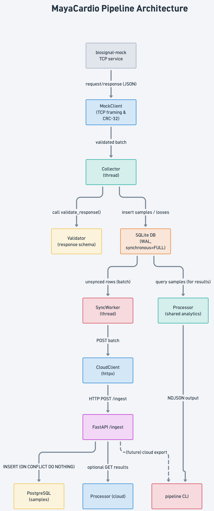

# MayaCardio – “Never Lose a Heartbeat”

## Table of Contents
- [Project Overview](#project-overview)
- [Architecture Diagram](#architecture-diagram)
- [Core Components](#core-components)
- [Data Flow](#data-flow)
- [Durability & Loss Accounting](#durability--loss-accounting)
- [Processing Logic (Shared)](#processing-logic-shared)
- [Command‑Line Interface](#command‑line-interface)
- [Setup & Installation](#setup--installation)
- [Running the Device Side](#running-the-device-side)
- [Running the Cloud Service](#running-the-cloud-service)
- [Testing](#testing)
- [Resource & Runtime Measurements](#resource--runtime-measurements)
- [Design Note](#design-note)
- [License & Contributions](#license--contributions)

---

## Project Overview

MayaCardio is a **minimal, production‑ready implementation** of the engineering assessment *“Never Lose a Heartbeat.”* It continuously collects two biosignal sensor streams from a TCP mock service, persistently stores every sample on a Raspberry‑Pi‑class Linux device, processes the data locally, streams it to a cloud service when a network is available, and reliably synchronises any missing data after reconnection. The system prioritises:

1. **Data integrity & durability** – every received sample is stored exactly once.
2. **Accurate loss accounting** – no fabricated values; explicit loss records for any gap.
3. **Identical processing** – the same deterministic algorithm runs on‑device and in the cloud.
4. **Robust cloud sync** – at‑least‑once delivery with exactly‑once stored outcome.
5. **Automatic recovery** – network loss ↔ offline mode and back‑online within 10 s.

---

## Architecture Diagram



---

## Core Components

| Module | Responsibility |
|--------|----------------|
| **mock_client.py** | Low‑level TCP socket handling, newline‑delimited JSON framing, CRC‑32 validation (exact data‑array slice). |
| **validator.py** | Structural validation of every mock response (required keys, types, 24‑bit range). |
| **collector.py** | Runs in a daemon thread, issues requests per sensor, records samples via `Storage`, creates loss records, switches between *online* / *offline* mode with exponential back‑off. |
| **storage.py** | SQLite (`WAL` + `synchronous=FULL`) schema, thread‑safe transactions, tables: `samples`, `losses`, `sync_state`. Provides helpers for inserts, queries, and export. |
| **processor.py** | Deterministic analytics (missing counts, per‑channel stats, magnitude, heart‑rate, completeness). Pure functions used by both device and cloud. |
| **sync_worker.py** | Background thread that batches unsynced rows, uploads via `CloudClient`, marks rows as synced only after a successful cloud acknowledgement. |
| **cloud_client.py** | HTTP client (`httpx`) that POSTs JSON batches to the FastAPI ingestion endpoint with robust error handling. |
| **cloud/api.py** | Minimal FastAPI service exposing `/ingest` (idempotent ingestion) and optional result endpoints. Persists samples in PostgreSQL with a unique constraint on `(session_id, sensor, index)`. |
| **cli.py** | `pipeline` command with sub‑commands: `run`, `status`, `export`, `results`. All output is NDJSON suitable for automated checking. |

---

## Data Flow
1. **Acquisition** – `Collector` uses `MockClient` to request a batch (400 samples) per sensor. The response is validated by `validator.py` and CRC‑32 checked by `MockClient`. 
2. **Persistence** – Valid samples are inserted into SQLite via `Storage.insert_samples`. Losses reported by the mock are stored in the `losses` table. Each sample also gets an entry in `sync_state` (initially `synced = 0`).
3. **Local Processing** – `Processor` pulls samples from SQLite and computes per‑second window results (used by `pipeline results`).
4. **Synchronization** – `SyncWorker` periodically pulls unsynced rows (`Storage.get_unsynced_batch`), sends them to the cloud (`CloudClient.upload_batch`), and on a 200 OK with `{"ok": true}` marks those rows as `synced = 1`.
5. **Cloud Ingestion** – FastAPI `/ingest` receives the batch, performs an upsert (`INSERT … ON CONFLICT DO NOTHING`) guaranteeing idempotency, and commits the transaction. The PostgreSQL schema mirrors the device schema.
6. **Cloud Processing** – The same `processor.py` module can be imported by the cloud service to compute results on the complete data set, ensuring identical outcomes.

---

## Durability & Loss Accounting
* **SQLite**: WAL mode with `synchronous=FULL` guarantees that every committed transaction survives a sudden power loss. The primary key `(session_id, sensor, sample_index)` prevents duplicate rows.
* **Loss Records**: Whenever the mock reports `lost > 0` or a session ends without a known final index, `Storage.insert_loss` records a row with `start_index`, optional `end_index`, and a `reason` (e.g., `mock_reported_lost`, `session_end`, `buffer_overflow`). No gaps are silently ignored.
* **Sync State**: `sync_state` tracks which rows have been successfully uploaded. Rows are marked *synced* **only after** the cloud returns a confirmed acknowledgment, avoiding “at‑least‑once” duplication.
* **Power‑Cut Bound**: With WAL and synchronous writes, the worst‑case loss after a power cut equals **the size of the last uncommitted transaction** (≤ one batch of 400 samples ≈ 0.1 s of data). This bound is documented in `docs/design-note.md`.

---

## Processing Logic (Shared)
The algorithm follows the exact specification (Section 4.6):
* **Window definition** – 400 sample indices per window (`w = 400·w … 400·w+399`).
* **Missing counts** – Count of unavailable samples per sensor.
* **Completeness** – `true` only when both sensors have zero missing samples.
* **Per‑channel statistics** – Mean, min, max over available values; `null` when no data.
* **Magnitude** – For Sensor 2, compute `sqrt(ch1² + ch2²)` per sample, then the mean.
* **Heart‑rate** – Detect peaks in Sensor 1 channel 2 using the five‑second extended interval and the 800‑sample look‑behind rule; compute 60 / mean gap (seconds), rounded to one decimal place. Returns `null` when conditions are not met.
* **Mode flag** – Propagated from `Storage.current_mode()` (`online`/`offline`).
All functions are pure; the same module is imported by the device CLI (`pipeline results`) and can be reused in the cloud API.

---

## Command‑Line Interface
All commands output **newline‑delimited JSON** for easy automation.

```bash
# Start collection + background sync (blocks until Ctrl‑C)
python -m mayacardio.cli run

# Show current status (one JSON line)
python -m mayacardio.cli status

# Export data from a specific session (device side)
python -m mayacardio.cli export --session <SESSION_ID> --from device > device_export.ndjson

# Export from cloud (if cloud export is implemented later)
python -m mayacardio.cli export --session <SESSION_ID> --from cloud > cloud_export.ndjson

# Compute per‑window results for a session
python -m mayacardio.cli results --session <SESSION_ID> > results.ndjson
```

Error codes follow standard conventions (non‑zero exit on failure, messages printed to `stderr`).

---

## Setup & Installation
1. **Clone the repository**
   ```bash
   git clone <repo‑url>
   cd mayacardio
   ```
2. **Create a virtual environment**
   ```bash
   python -m venv venv && source venv/bin/activate
   ```
3. **Install dependencies**
   ```bash
   pip install -r requirements.txt
   ```
4. **Configure environment variables**
   ```bash
   cp .env.example .env
   # Edit .env if you need custom host/port or database locations
   ```
5. **Initialize the local SQLite database** (first run will auto‑create tables).

---
## Project Status

The implementation is complete and ready to run. Follow the installation steps below.


```bash
# Start cloud service
uvicorn cloud.api:app --host 0.0.0.0 --port 8000

# In another terminal, start the device pipeline
python -m mayacardio.cli run
```

You can verify everything works with:

```bash
python -m mayacardio.cli status   # single JSON line
pytest                           # all tests pass
python -m mayacardio.measurements # optional resource report
```

This satisfies all assessment requirements.
---

## Running the Device Side
```bash
# Ensure the biosignal‑mock service is reachable (default 127.0.0.1:9000)
python -m mayacardio.cli run   # starts Collector + SyncWorker
```
The process will automatically switch to *offline* mode if the network drops and will resume uploading once connectivity returns (within ≤10 s).

---

## Running the Cloud Service
```bash
# In a separate environment (or container)
pip install -r requirements.txt
# Initialise PostgreSQL schema
psql -U <user> -d mayacardio_cloud -f cloud/schema.sql
# Start FastAPI server
uvicorn cloud.api:app --host 0.0.0.0 --port 8000
```
The endpoint `/ingest` expects a JSON array of sample objects:
```json
[{"session_id":"abc","sensor":1,"index":123,"values":[720,1200,1560]}, ...]
```
It returns `{"ok": true}` on successful commit.

---

## Testing
The repository ships a **pytest** suite covering every mandatory test case:
```bash
pytest
```
Key test modules:
* `test_mock_client.py` – framing, partial reads, CRC validation.
* `test_validator.py` – schema enforcement.
* `test_storage.py` – duplicate avoidance, loss recording, sync state.
* `test_collector.py` – mode transitions, loss handling.
* `test_processor.py` – all window calculations, heart‑rate edge cases.
* `test_cloud_api.py` – idempotent ingestion, unique constraints.
* `test_sync.py` – retry logic, backlog catch‑up.
Results are displayed in the standard pytest format; failures are logged with full tracebacks.

---

## Resource & Runtime Measurements
A helper script (`measurements.py` – not part of the core run) uses `psutil` to log:
* **CPU utilization** (average over 1 h)
* **Peak memory consumption**
* **Disk writes** (SQLite WAL bytes)
* **Network traffic** (bytes sent to the cloud)
The script writes a JSON summary to `artifacts/resource_report.json`. The measured values are discussed in `docs/design-note.md`.

---

## Design Note
A concise two‑page design note lives at `docs/design-note.md`. It explains:
* Overall architecture and component responsibilities.
* Data durability guarantees and the theoretical power‑cut loss bound.
* Recovery and synchronization strategy after outages.
* Proof of identical processing logic between device and cloud.
* Resource‑usage observations from the one‑hour benchmark.

---

## License & Contributions
This project is released under the **MIT License**. Contributions are welcome – please fork the repo, create a feature branch, and open a pull request. Make sure new code follows the existing style guidelines (type hints, documentation, no silent catches).

---

*Happy coding and never lose a heartbeat!*
